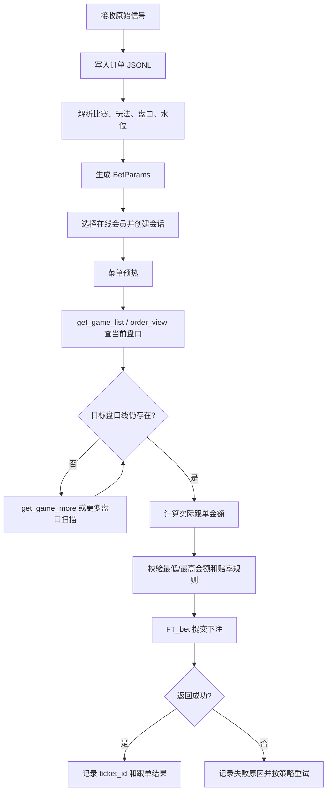

# 跟单流程与信号字段说明

本文说明一条体育注单信号从接收、解析、查水到提交跟单所需要的字段，以及这些字段在项目中的转换关系。

> 注意：会员的 `uid`、`ver`、Cookie、代理地址属于登录会话信息，不应放进信号消息或普通业务日志。文中的会员字段均使用占位符。

## 快速结论

一条可跟单的足球大小球信号，最少需要能够确定以下信息：

```text
比赛 ID（gid）
球种（gtype）
玩法和时段（滚球/早盘、全场/半场、大小球）
选择方向（大/小）
目标盘口线（例如 3.5/4）
原始水位（例如 0.89）
源单金额（stake）
来源和订单号（target、orderId，用于去重和追踪）
```

引擎会把这些信息转换为皇冠下注接口需要的盘口编码：

```jsonc
{
  "gid": "8994721",       // 比赛 ID
  "gtype": "FT",          // 球种：足球
  "wtype": "ROU",         // 玩法：全场滚球大小球
  "rtype": "ROUH",        // 方向玩法：全场滚球小球
  "chose_team": "H",      // 方向代码：H=小球，C=大球
  "ioratio": "0.89",      // 当前水位/赔率
  "con": "-4",             // 盘口编码第一部分
  "ratio": "-50",          // 盘口编码第二部分
  "f": "1R"                // 下注来源/请求标记
}
```

## 完整流程



流程入口和字段推导主要位于：

- `src/hdzz/core/follower/engine.py:2227`：从订单推导 `BetParams`
- `src/hdzz/core/follower/models.py:8`：`BetParams` 数据结构
- `src/hdzz/core/follower/engine.py:6963`：构造最终下注表单

## 第一层：原始信号字段

项目会尽量保留后台返回的原始字段到订单的 `raw` 对象中。字段名称可能因来源接口不同而变化，解析器会按多个候选名称兜底。

| 原始字段 | 是否必需 | 作用 | 示例 |
|---|---:|---|---|
| `raw._EVENT` | 是 | 比赛 ID，最终映射为 `gid` | `8994721` |
| `raw.GTYPE` | 否 | 球种，默认足球 `FT` | `FT` |
| `raw.WAGERSTYPE` | 是 | 判断大小、让球、独赢，以及滚球/半场 | `(滚球) 大 / 小` |
| `raw.MARKET` | 建议 | 判断滚球或非滚球 | `rb` |
| `order.line` | 是 | 已解析的选择和盘口线 | `小 3.5 / 4` |
| `order.odds` | 是 | 原始水位 | `0.89` |
| `raw.ODDS` / `raw.IORATIO` | 备用 | 当 `order.odds` 没有值时提供水位 | `0.89` |
| `raw.SHOWTEXT_ORDER_TYPE_IORATIO` | 备用但常用 | 从展示文本兜底解析选择、盘口和水位 | `小 3.5 / 4 @ 0.89` |
| `raw.ORDER_TYPE` | 可选 | 选择方向或球队 | `小` |
| `raw.ORDER_CON` | 可选 | 不带方向的盘口线 | `3.5 / 4` |
| `raw.GOLD` / `order.stake` | 是 | 源单金额，用于计算跟单金额 | `50.0` |
| `raw.TID` / `orderId` | 是 | 订单唯一 ID，用于去重和追踪 | `25121585867` |
| `target` | 是 | 来源后台或目标队列名称 | `claude666` |

### 字段兜底规则

本项目不会要求每个后台都返回完全相同的字段。例如截图对应的订单没有 `ORDER_TYPE`、`ORDER_CON`、`IORATIO`，但仍可通过以下字段解析：

```text
SHOWTEXT_ORDER_TYPE_IORATIO = 小 3.5 / 4 @ 0.89
```

解析结果为：

```text
line = 小 3.5 / 4
odds = 0.89
```

如果既没有结构化字段，也没有展示文本中的盘口和水位，就不能可靠跟单，应进入失败或人工处理。

## 第二层：归一化订单字段

写入 `app/orders/<target>.jsonl` 后，订单通常具有以下统一结构：

```jsonc
{
  "ts": 1787245686,                                      // 系统接收时间戳
  "bet_ts": 1787202478,                                  // 后台注单时间戳
  "target": "claude666",                                // 来源后台/目标队列
  "orderId": "25121585867",                             // 注单唯一 ID
  "account": "ctk1aolamu",                              // 后台下注账号
  "sport": "足球",                                      // 球种
  "stake": "50.0",                                      // 源单金额，不一定是实际跟单金额
  "odds": "0.89",                                       // 源单水位，提交前可能被查水更新
  "league": "欧洲联赛外围赛-附加赛",                    // 联赛名称
  "sides": "乔治罗尼亚 v 提比利锡1999 (2 - 0)",        // 主客队和信号时比分
  "betType": "(滚球) 大 / 小",                          // 玩法和比赛时段
  "line": "小 3.5 / 4",                                 // 选择方向和盘口线
  "date": "08-20-2026",                                 // 注单日期
  "time": "13:07:58",                                  // 注单时间
  "downline": "45143304",                               // 来源下线/账号编号
  "raw": {}                                              // 后台返回的完整原始字段
}
```

其中：

- `raw`：保留后台原始对象，排查字段缺失时优先查看。
- `betType`：用于识别玩法和时段。
- `line`：用于识别方向和目标盘口线。
- `odds`：作为初始水位，提交前可能被查水结果更新。
- `stake`：只是源单金额，不一定等于最终下注金额。
- `sides`、`league`、`date`、`time`：主要用于展示、检索和日志。

## 第三层：BetParams 盘口参数

`BetParams` 是下注前的核心盘口对象：

| 参数 | 含义 | 足球大小球示例 |
|---|---|---|
| `gid` | 比赛 ID | `8994721` |
| `gtype` | 球种 | `FT` |
| `wtype` | 玩法类型 | `ROU` |
| `rtype` | 玩法加方向 | `ROUH` |
| `chose_team` | 方向代码 | 大小球：`H`=小、`C`=大；让球盘：`H`=主队、`C`=客队 |
| `ioratio` | 当前水位 | `0.89` |
| `con` | 盘口编码第一部分 | `-4` |
| `ratio` | 盘口编码第二部分 | `-50` |
| `f` | 下注来源标记 | `1R` |

### `wtype` 和 `rtype`

| 场景 | `wtype` | 大球 `rtype` | 小球 `rtype` |
|---|---|---|---|
| 全场滚球大小 | `ROU` | `ROUC` | `ROUH` |
| 上半场滚球大小 | `HROU` | `HROUC` | `HROUH` |
| 全场今日/早盘大小 | `OU` | `OUC` | `OUH` |
| 上半场今日/早盘大小 | `HOU` | `HOUC` | `HOUH` |

让球盘的类型和方向：

| 场景 | `wtype` | 主队 `rtype` | 客队 `rtype` | `chose_team` 含义 |
|---|---|---|---|---|
| 全场滚球让球 | `RE` | `REH` | `REC` | `H`=主队，`C`=客队 |
| 全场今日/早盘让球 | `R` | `RH` | `RC` | `H`=主队，`C`=客队 |
| 上半场滚球让球 | `HRE` | `HREH` | `HREC` | `H`=主队，`C`=客队 |

例如信号是“主队 -0.5”，表示选择主队并让半球：

```jsonc
{
  "gid": "8741163",       // 比赛 ID
  "gtype": "FT",          // 球种：足球
  "wtype": "RE",          // 全场滚球让球
  "rtype": "REH",         // 滚球让球主队方向
  "chose_team": "H",      // H=主队，C=客队
  "ioratio": "0.96",      // 当前水位
  "con": "1",              // 盘口编码第一部分
  "ratio": "100",          // 盘口编码第二部分
  "f": "1R"                // 滚球下注标记
}
```

这个例子的盘口编码解码为：

```text
盘口线 = -con + ratio / 200
      = -1 + 100 / 200
      = -0.5
```

如果选择客队 `+0.5`，则方向和编码相应变为：

```text
chose_team = C
rtype      = REC
con        = -1
ratio      = -100
盘口线      = -(-1) + (-100 / 200) = +0.5
```

方向代码约定：

```text
大小球：C = 大球，H = 小球
让球盘：H = 主队，C = 客队
```

### `con` 和 `ratio`

`con`、`ratio` 不是用户看到的盘口字符串，而是皇冠接口的盘口编码。以 `小 3.5/4` 为例：

```text
3.5/4 的平均值 = 3.75
小球方向       = 负号
编码结果       = con=-4, ratio=-50
```

因此，不能只把字符串 `3.5/4` 原样传给下注接口。

## 第四层：会员和会话字段

下注请求还必须绑定一个有效会员：

| 会员字段 | 是否必需 | 说明 |
|---|---:|---|
| `member.id` | 是 | 本地会员记录 ID |
| `base_url` | 是 | 会员站点地址 |
| `uid` | 是 | 当前登录用户会话 ID |
| `ver` | 是 | 当前站点版本参数 |
| `cookie` | 是 | 登录 Cookie |
| `proxy` | 否 | 会员对应代理 |
| `status` | 是 | 必须处于在线或可用状态 |

会员会话信息不从信号中传递，而是由跟单引擎从 `app/data/arsenal.json` 读取。

## 第五层：金额和跟单设置

源单金额和实际下注金额是两个概念：

```text
source_stake = 信号原始金额
stake        = 本次实际下注金额
golds        = 最终传给下注接口的金额
```

常见计算方式：

```text
按比例：stake = source_stake × ratio_percent / 100
固定金额：stake = fixed_amount
```

例如：

```text
source_stake = 50
ratio_percent = 35%
stake = 17.5，按系统规则取整为 18
```

但会员端可能要求：

```text
gold_gmin <= golds <= gold_gmax
```

如果会员最低投注额是 `50`，那么 `golds=18` 会被拒绝。此时应调整跟单金额或分单策略，而不是修改盘口参数。

## 第六层：最终足球下注表单

对于足球，最终请求使用 `p=FT_bet`。字段如下：

```jsonc
{
  "p": "FT_bet",                         // 足球下注接口名称
  "uid": "<member uid>",                 // 当前会员登录用户 ID
  "ver": "<member ver>",                 // 当前会员接口版本
  "langx": "zh-cn",                      // 语言
  "odd_f_type": "H",                     // 赔率格式：香港盘
  "golds": "50",                         // 实际下注金额
  "gid": "8994721",                      // 比赛 ID
  "gtype": "FT",                         // 球种：足球
  "wtype": "ROU",                        // 玩法：全场滚球大小球
  "rtype": "ROUH",                       // 方向玩法：全场滚球小球
  "chose_team": "H",                     // 方向代码：H=小球，C=大球
  "ioratio": "0.89",                     // 提交时最新水位
  "con": "-4",                            // 盘口编码第一部分
  "ratio": "-50",                         // 盘口编码第二部分
  "autoOdd": "Y",                        // 允许按接口规则处理赔率
  "timestamp": "<current milliseconds>", // 当前毫秒时间戳
  "timestamp2": "",                      // 备用时间戳字段
  "isRB": "Y",                            // 是否滚球：Y=是，N=否
  "imp": "N",                             // 站点下注控制标记
  "ptype": "",                            // 足球通常为空；篮球通常为 0
  "isYesterday": "N",                    // 是否昨日赛事：N=否
  "f": "1R"                               // 下注来源/请求标记
}
```

篮球使用 `p=Other_bet`，并通常需要 `ptype=0`，不能直接复用足球的 `FT_bet`。

让球盘的足球下注表单只需要替换盘口相关字段，其他会话和通用字段保持一致：

```jsonc
{
  "p": "FT_bet",                         // 足球下注接口
  "uid": "<member uid>",                 // 会员登录用户 ID
  "ver": "<member ver>",                 // 接口版本
  "langx": "zh-cn",                      // 语言
  "odd_f_type": "H",                     // 香港盘
  "golds": "50",                         // 实际下注金额
  "gid": "8741163",                      // 比赛 ID
  "gtype": "FT",                         // 足球
  "wtype": "RE",                         // 全场滚球让球
  "rtype": "REH",                        // 主队让球方向
  "chose_team": "H",                     // H=主队，C=客队
  "ioratio": "0.96",                     // 提交时最新水位
  "con": "1",                            // -0.5 的盘口编码
  "ratio": "100",                        // -0.5 的分盘编码
  "autoOdd": "Y",                        // 自动赔率处理
  "timestamp": "<current milliseconds>", // 当前毫秒时间戳
  "timestamp2": "",                      // 备用时间戳
  "isRB": "Y",                            // 滚球标记
  "imp": "N",                             // 站点控制标记
  "ptype": "",                            // 足球为空
  "isYesterday": "N",                    // 非昨日赛事
  "f": "1R"                               // 滚球下注标记
}
```

让球盘默认严格跟随原始盘口线。例如原信号是主队 `-0.5`，查水后如果当前盘口变成 `-0.25`，引擎不会直接换线下注，而会进入盘口线恢复或重试流程。

## 提交前的实际过程

引擎不是生成参数后立即下注，通常还会执行以下检查：

1. 校验会员 `uid/ver/cookie` 是否存在。
2. 根据 `gid`、`wtype`、`chose_team` 请求 `FT_order_view`。
3. 用 `get_game_list` 或 `get_game_more` 刷新目标盘口线和最新水位。
4. 默认严格跟随原始盘口线，不允许自动换到另一条盘口线。
5. 检查赔率上下限设置。
6. 检查会员最低和最高下注额。
7. 提交 `FT_bet`。
8. 根据 XML 返回记录 `ok`、`ticket_id`、`message`；超时或盘口关闭时按重试策略处理。

## 结果字段

跟单结果通常包含：

| 字段 | 说明 |
|---|---|
| `ok` | 是否成功下注 |
| `ticket_id` | 成功后的会员注单号 |
| `member` / `member_id` | 实际使用的会员 |
| `stake` | 本次实际下注金额 |
| `params` | 当前最终盘口参数 |
| `backend_params` | 从原始信号推导出的初始参数 |
| `submit_params` | 实际准备提交给 `FT_bet` 的参数快照 |
| `message` | 成功、失败或重试原因 |
| `order_view_head` | 提交前查水返回的关键字段 |

常见失败原因：

```text
缺少 raw._EVENT          → 无法确定 gid
会员登录信息缺失         → 无法创建下注会话
盘口线暂时找不到         → LINE_NOT_FOUND，等待或重试
盘口已经关闭             → 1X015 或类似错误
下注金额低于最低投注     → golds < gold_gmin
赔率超出设置范围         → follow_min_odds / follow_max_odds
```

## 本例的最小可跟单数据

如果只保留刚才截图对应信号中真正参与跟单的字段，可以整理成：

```jsonc
{
  "target": "claude666",                 // 来源后台/目标队列
  "orderId": "25121585867",              // 注单唯一 ID，用于去重和追踪
  "raw": {
    "_EVENT": "8994721",                 // 比赛 ID，映射为 BetParams.gid
    "GTYPE": "FT",                        // 球种：足球
    "MARKET": "rb",                       // 市场：滚球
    "WAGERSTYPE": "(滚球) 大 / 小",       // 玩法和时段
    "SHOWTEXT_ORDER_TYPE_IORATIO": "小 3.5 / 4 @ 0.89" // 选择、盘口和水位展示文本
  },
  "stake": "50.0",                       // 源单金额
  "odds": "0.89"                          // 源单水位
}
```

引擎会从这组字段推导出 `BetParams`，再结合会员会话和跟单设置生成最终下注请求。

## 设计建议

- 信号层保存原始 `raw`，不要只保存页面展示文本。
- 归一化层至少保存 `orderId`、`target`、`stake`、`odds`、`betType`、`line` 和 `raw._EVENT`。
- 下注层只使用经过查水更新后的 `ioratio/con/ratio`。
- `uid`、Cookie、代理等敏感信息只放在会员池和运行时会话中。
- 每次下注都保存 `backend_params` 和 `submit_params`，方便判断是信号问题、盘口变化还是会员限制。
